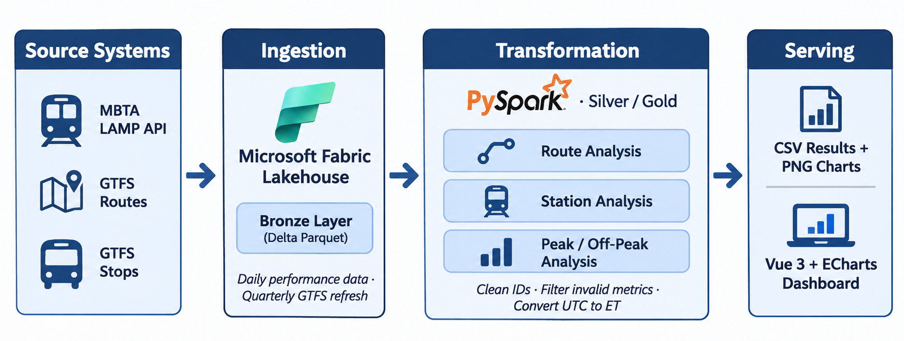
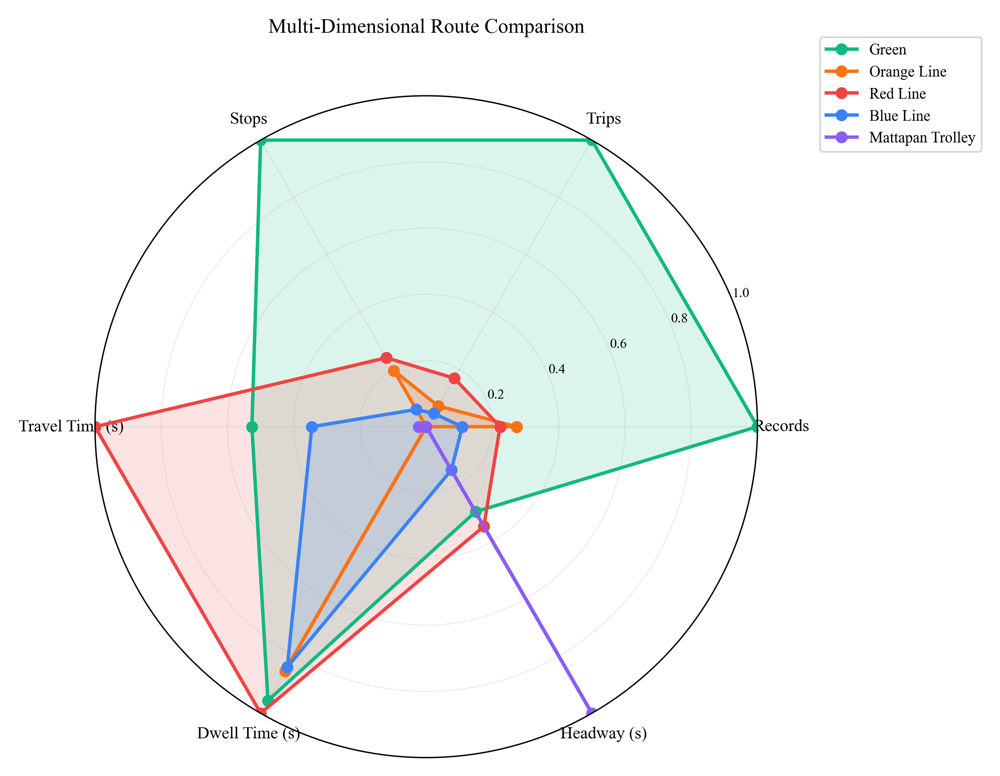
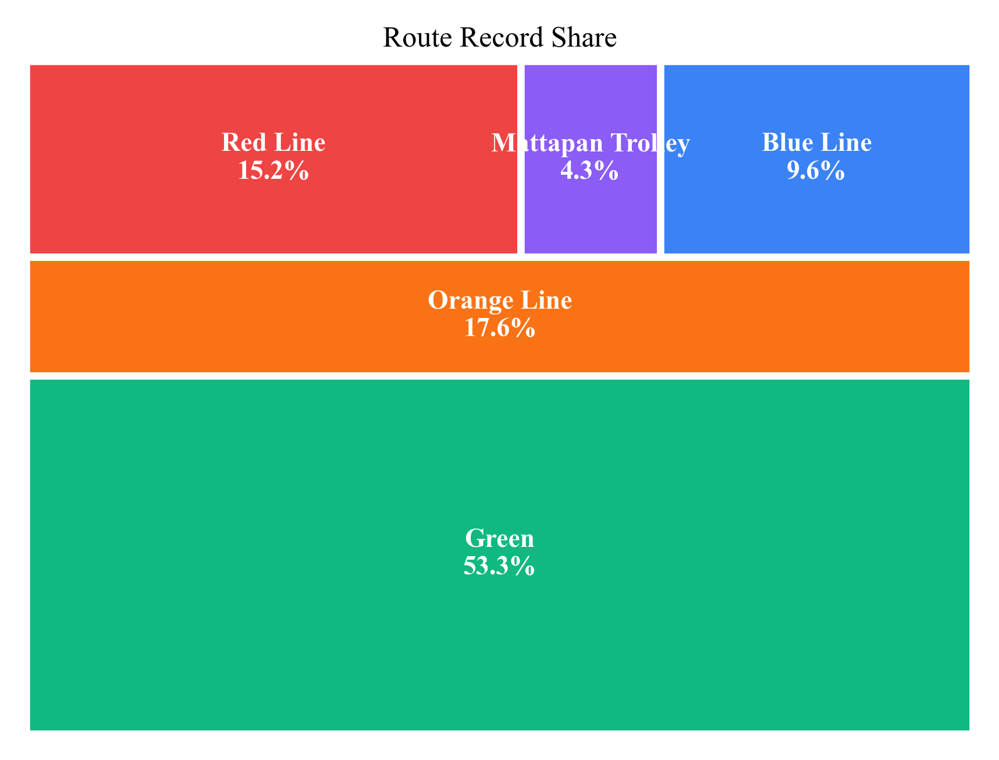
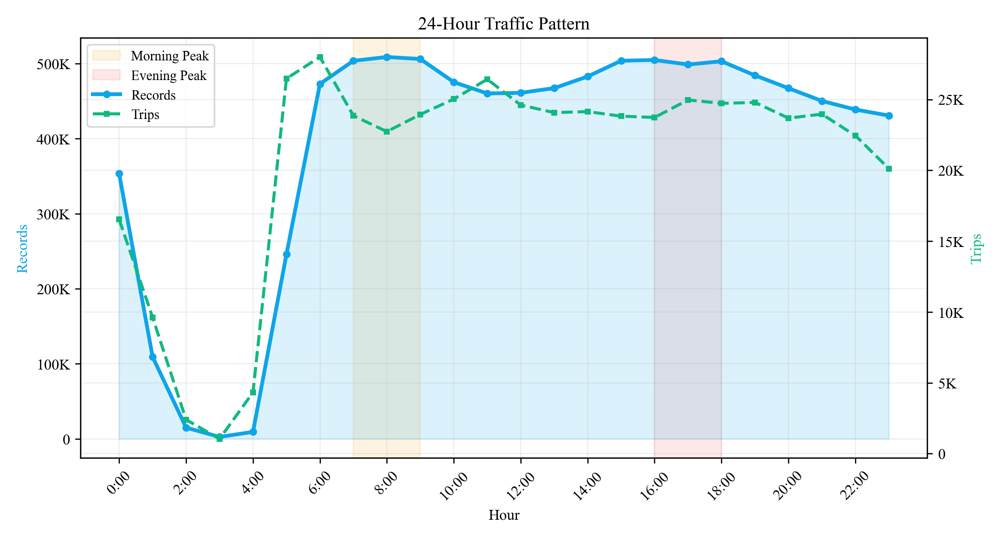
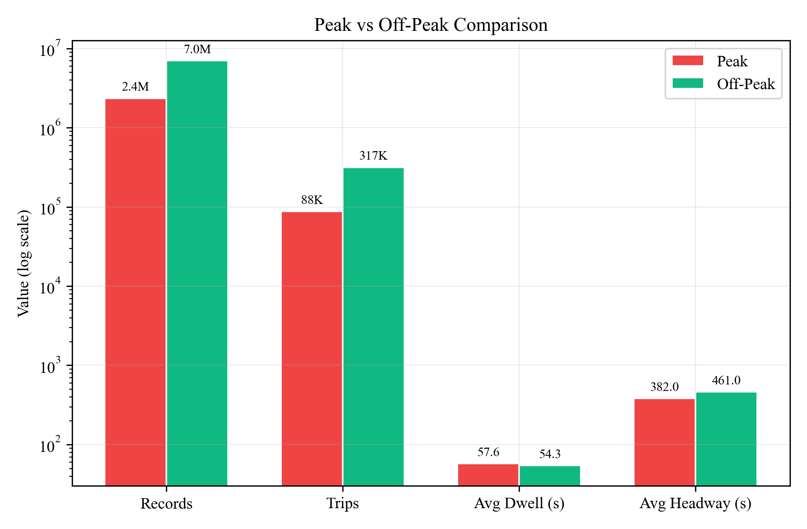

# MBTA Subway Analytics

A data engineering pipeline that transforms raw MBTA subway operational records into actionable performance insights for routes, stations, and time periods.

Live dashboard: <https://data707.houzhaohan.vip>

---

## 1. Problem, Consumer, and Data

### Who Is the Intended Consumer?

The primary consumers are **MBTA operations managers and transit planners** who need a reliable, data-driven view of subway system performance. Secondary consumers include city transportation analysts, data engineering students studying transit data pipelines, and software engineers evaluating serving-layer design for analytical products.

### What Problem or Need Are We Addressing?

Modern transit agencies generate millions of operational records daily—vehicle positions, stop events, timestamps—but this raw stream is rarely usable for decision-making without substantial cleaning, alignment, and modeling. The MBTA, like many transit operators, needs to answer questions such as:

- Which routes carry the highest observation volume?
- Which stations exhibit the longest dwell times, and are they outliers or systemic?
- How do peak-period operations compare to off-peak in terms of headway and dwell?
- Are there systematic differences between morning and evening rush hours?

Answering these from raw records requires joining multiple source systems, normalizing inconsistent identifiers, and handling pervasive data-quality issues—exactly the work this pipeline systematizes.

### What Value Does the Data Product Provide?

The product delivers three analytical lenses over the same underlying data:

1. **Route-level performance** — compare total records, trips, stops, and average travel/dwell/headway metrics across all subway lines.
2. **Station-level efficiency** — surface stations with unusually long or short dwell times, rank by observation volume, and correlate records with infrastructure count (routes served, platforms).
3. **Temporal patterns** — quantify peak vs. off-peak differences, morning vs. evening rush, and the 24-hour traffic curve.

### Major Datasets and Source Systems

The data is the **MBTA Subway Dataset**, published by the Massachusetts Bay Transportation Authority (MBTA) for analyzing Boston subway operations — train on-time performance, travel time, station dwell time, and service reliability. All tables used in this project were provided by the course instructor via the Microsoft Fabric workspace at <https://app.fabric.microsoft.com/>.

### Data Characteristics That Matter

- **Volume**: ~9.4 million records across 8 subway routes, 77 stops, spanning roughly one year of operation.
- **Grain**: One record per train stop event (platform × trip × timestamp).
- **Update frequency**: The full performance table is refreshed daily; static dimensions are updated quarterly or when the MBTA changes service.
- **Critical fields**: Travel time, dwell time, and headway measurements — all numeric, with meaningful zero/negative sentinel values indicating sensor failure.
- **Identifier complexity**: Two route identifiers exist (branch vs. trunk), and two stop identifiers exist (platform vs. parent station). Both require coalescing to produce consistent aggregates.

---

## 2. Pipeline Architecture and Implementation

### Pipeline Diagram

### Storage

The pipeline runs on **Microsoft Fabric**, with data stored in a lakehouse architecture organized as:

| Layer                | Location                               | Format              | Content                                                                                        |
| -------------------- | -------------------------------------- | ------------------- | ---------------------------------------------------------------------------------------------- |
| Bronze (raw landing) | Fabric Lakehouse                       | Delta Parquet       | Three source tables ingested as-is from LAMP/GTFS                                              |
| Silver (cleaned)     | Fabric Warehouse                       | Delta Parquet       | Dimension-joined, type-corrected base tables                                                   |
| Gold (analytical)    | Fabric Warehouse + local results table | Delta Parquet → CSV | Route summary, station summary, hourly summary, peak comparison, and four other derived tables |

### Ingestion

Ingestion is orchestrated by Microsoft Fabric pipelines that:

1. Pull daily incremental records from the MBTA LAMP API into the lakehouse bronze layer.
2. Refresh the static GTFS route and stop dimensions whenever the MBTA publishes a new schedule (typically quarterly).
3. Materialize the joined, typed table for downstream notebooks.

All three notebooks read directly from warehouse table names — no file paths are hard-coded, making the pipeline portable across environments.

### Transformation, Data Quality, and Data Model

#### Four Meaningful Transformations

**T1 — Route trunk coalescing.** The raw data reports branch lines (e.g., Green-B, Green-C, Green-D, Green-E) under separate identifiers even though they operate on the same physical trunk. We collapse every branch identifier to its trunk route, reducing the effective route count from 12+ branches to 8 trunk routes — the number the MBTA itself reports publicly. This ensures route-level statistics are not diluted by splitting records across artificial branches.

**T2 — Station parent coalescing.** A single physical station (e.g., Park Street) often has multiple platform-level identifiers. We group all platform records under a single physical station identifier so that station-level dwell times and record counts reflect the actual station, not fragments of it.

**T3 — Timezone-aware period classification.** Timestamps arrive in UTC from the LAMP system. We convert them to Eastern Time and then classify each record into one of three periods: Morning Peak (weekdays 07:00–09:59), Evening Peak (weekdays 16:00–18:59), or Off-Peak (everything else including all weekends). Without the timezone conversion, every period would be misclassified by 4–5 hours.

**T4 — Filtered aggregation.** Metric fields such as travel time, dwell time, and headway contain sentinel values (zero or negative numbers) written by sensors when no real measurement is available. We exclude these invalid observations from every average so that a route with high sensor failure does not appear artificially fast or efficient.

#### Two Data-Quality Issues Addressed

**DQ1 — Sensor failure encoded as numeric sentinels.** When on-board sensors fail or no reading is available, the LAMP system writes a zero or negative number into every metric field. Without filtering, an average dwell time would be pulled toward zero for routes with many sensor failures — a route would appear efficient simply because half its readings were missing. We exclude these invalid values from every aggregate, so stations with no valid dwell observations report no average rather than an artificially low one.

**DQ2 — Missing timestamps.** Some records have no usable timestamp at all, making it impossible to determine what period they belong to. We drop these records before period classification and flag in the final report that off-hours periods may have sparse coverage, so consumers do not interpret small sample sizes as zero activity.

#### Resulting Data Model

The gold layer produces eight analytic tables organized into three groups sharing a consistent grain:

- **Route tables** — one row per trunk route with total records, trips, stops, and averages for travel time, dwell time, and headway.
- **Station tables** — one row per physical station plus two ranked top-10 subsets (by record count and by average dwell time). Each station reports route and platform counts alongside its metrics.
- **Period tables** — one row per time bucket across four granularities: Peak vs. Off-Peak (2 rows), Morning vs. Evening vs. Off-Peak (3 rows), hour-of-day (24 rows), and route-by-period type (combinations).

All tables share consistent metric naming and use seconds as the base time unit.

### Serving

The pipeline serves results through two parallel channels: static CSV artifacts for analysts and a live Vue 3 single-page application for interactive exploration.

#### Example 1 — Route Performance Dashboard

The route-level summary table drives the route dashboard. The radar chart below normalizes six dimensions (records, trips, stops, travel time, dwell time, headway) to [0,1] and compares all routes on a single canvas — making it immediately visible that the Green Line dominates in observation volume while the Red Line has the longest average travel time.

The treemap below complements this by showing record volume share per route. Together, these two visualizations answer "how does each route compare?" and "which routes dominate the data volume?" — two questions that would require raw SQL aggregation otherwise.

#### Example 2 — Peak vs. Off-Peak Dashboard

The hourly and peak-comparison tables together power the temporal analysis. The 24-hour line chart below shows the classic transit double-peak curve, with the morning peak shaded in orange and the evening peak in red. The 4:00 AM trough and the post-peak tail are both visible — details that are invisible in a simple peak/off-peak binary split.

The grouped bar chart compares peak vs. off-peak across four metrics on a log scale, revealing that while records and trips drop by roughly 3× off-peak, average headway increases by a smaller factor — evidence that headway is partly governed by schedule policy, not purely by ridership volume.

#### Static Frontend Delivery

A Vue 3 single-page application loads pre-computed JSON snapshots of the gold tables directly from the browser. This design means:

- **No backend required** — the built output can be served from any static host with zero operational cost.
- **Instant cold start** — no database connection or API round trips; everything renders from cached JSON.
- **Security simplicity** — no credentials, no server surface, no injection risk.

---

## 3. Production / Future-State Design

### Data Contract

| Field                         | Value                                                                                                                                             |
| ----------------------------- | ------------------------------------------------------------------------------------------------------------------------------------------------- |
| **Owner**                     | MBTA Data Engineering team                                                                                                                        |
| **Consumers**                 | Operations managers, transit planners, analytics team, external researchers                                                                       |
| **Grain**                     | One row per trunk route, per physical station, or per time bucket — documented per table                                                          |
| **Schema**                    | Field names are stable across all gold tables; see the pipeline section above                                                                     |
| **Refresh expectation**       | Daily incremental refresh of route, station, and period summaries by 06:00 ET; static dimensions refreshed within 24 hours of an MBTA GTFS update |
| **Data-quality expectations** | Average metric fields are reported only when at least 5 valid positive observations exist; counts are always non-null                             |
| **Access**                    | Role-based access: read-only for analysts, read-write for downstream pipelines; signed-token API for external consumers, rotated every 90 days    |
| **Definitions**               | Peak = weekdays 07:00–09:59 or 16:00–18:59 ET; Off-Peak = all other periods; valid observation = metric greater than zero and timestamp present   |

### Orchestration

In production, the pipeline would run as a DAG orchestrated by **Microsoft Fabric Pipelines**.

Key orchestration considerations:

- **Daily schedule**: Triggers at 03:00 ET to catch the previous day's late-arriving records.
- **Retry policy**: 3 retries with exponential backoff on each ETL step; notification to the data owner after 2 consecutive failures.
- **Dependency ordering**: Dimension refresh must complete before the joined performance table materialization; all three analysis scripts can run in parallel after that.

### Governance and Security

- **Ownership**: Each gold table has a named owner visible in the Fabric catalog with contact information.
- **Lineage**: Microsoft Fabric automatically tracks lineage from each gold table back to the three source tables; this is critical when a consumer asks, "Why did this average change last Tuesday?"
- **Access controls**: The warehouse uses column-level masking for any future personally identifiable fields. Read-only API access uses signed tokens rotated every 90 days.
- **Retention**: Three years for the raw bronze layer, ten years for aggregated silver/gold results, and indefinite retention of GTFS snapshots for schedule audit trails.

### Monitoring / DataOps

The most relevant monitoring for this pipeline is **data-quality monitoring** and **freshness monitoring**, rather than resource utilization monitoring (which Fabric already handles):

| Metric                                      | Alert Threshold                 | Rationale                                                   |
| ------------------------------------------- | ------------------------------- | ----------------------------------------------------------- |
| Row count per day                           | < 90% of 30-day rolling average | A sudden drop means ingestion or the upstream API broke     |
| Null rate of timestamps                     | > 5%                            | Timestamp coalescing logic may have a regression            |
| Null rate of average dwell time (any route) | > 20%                           | The invalid-value filter may have been accidentally removed |
| Orchestration pipeline success rate         | Any failure                     | Auto-retry, then page the on-call data owner                |
| Gold-layer artifact freshness               | Modification time > 25 hours    | The final deliverable is stale                              |

---

## 4. Key Engineering Decisions and Tradeoffs

### Decision 1: Branch trunk coalescing

**Alternatives considered:**

- Keep branch routes separate (Green-B, Green-C, and so on) and report them independently.
- Aggregate only some branches and leave others separate based on historical MBTA conventions.

**Why we chose trunk coalescing:** The MBTA's public reporting uses trunk routes, so a consumer seeing "Green" expects all four branches collapsed. Keeping branches separate would produce 12+ routes with some having very low record counts, introducing noise into averages and making cross-route comparisons unfair.

**Tradeoffs:** Trunk coalescing hides branch-specific differences. A future consumer asking "how does Green-B compare to Green-C?" would need to re-aggregate from the base table. The fix is simple: include both trunk and branch identifiers as dimensions in a denormalized base table.

### Decision 2: Filtered aggregation over valid observations

**Alternatives considered:**

- Treat zeros as valid observations and include them in the average.
- Impute missing values with a per-route median.
- Drop rows with any invalid metric before aggregation.

**Why we chose filtered aggregation:** Zeros are sentinel values, not real measurements. Imputation introduces model complexity, and consumers (like dwell-time analysts) may want to know *where* data is missing, not have it filled in. Dropping rows entirely is too aggressive — a row with invalid dwell but valid travel time is still useful for travel-time analysis. Filtering is simple, explicit, and gives consumers no value where no valid observations exist.

**Tradeoffs:** Routes with pervasive sensor failure will report no average rather than an estimate, which some visualization tools cannot handle gracefully. The frontend currently filters out these empty values at render time.

---

## 5. Lessons Learned

### Most Important Technical Challenges

**Challenge 1 — The identifier-coalescing trap.** The most surprising bug during development was that an identifier-coalescing chain returned nothing for a small percentage of records where both source fields were missing. Those records then disappeared from all route-level aggregates, and the total no longer matched the source table. The fix was to ensure every record has a final fallback value, but more importantly, we learned to always verify that transformed row counts match source row counts before trusting aggregates.

**Challenge 2 — Timezone awareness.** Running the period-classification script without an explicit Eastern Time setting shifted every period by 4–5 hours. Morning peak records were labeled "off-peak," evening peak records were labeled "morning peak." The fix was a single configuration line, but it exposed a subtle dependency: every notebook touching time-aware fields must set timezone, or results are silently wrong.

### What We Learned

1. **Data quality is not a phase — it is every phase.** Every transformation is a potential data-quality fix. The sentinel-value rule, the identifier coalescing chains, the timezone config — none of these are "optional" steps after loading. They are part of the model definition.

2. **Explainability in transformations is critical.** Every coalescing chain and every filter rule needs a comment explaining why. When we revisited the scripts two weeks after writing them, several lines had us staring for minutes remembering the LAMP data's quirks.

### What We'd Improve With More Time

- **Add branch-level detail tables** alongside trunk-level summaries so consumers can answer branch-specific questions without re-running ETL.
- **Set up a DuckDB-based query interface** for ad-hoc analysis alongside the static dashboard — giving consumers both fast pre-built charts and the freedom to slice freely.
- **Version control the results artifacts** (CSV + JSON) via DVC so that dashboard rollbacks are trivial when a bad ETL run corrupts gold tables.

---

## Contact Us

**Zhaohan Hou**
School of Data and Information Sciences
University of North Carolina at Chapel Hill
Chapel Hill, NC 27514
[houzh@unc.edu](mailto:houzh@unc.edu)

**Jiaxin Wang**
School of Data and Information Sciences
University of North Carolina at Chapel Hill
Chapel Hill, NC 27514
[jwang3@unc.edu](mailto:jwang3@unc.edu)
